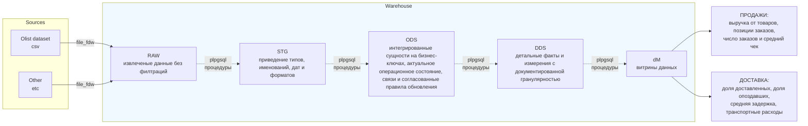

# Схема — Olist

## Список таблиц

| Таблица | Описание |
|---|---|
| [`olist_customers_dataset.csv`](#olist_customers_dataset) | Клиенты |
| [`olist_geolocation_dataset.csv`](#olist_geolocation_dataset) | Геолокация по почтовым индексам |
| [`olist_order_items_dataset.csv`](#olist_order_items_dataset) | Позиции заказов |
| [`olist_order_payments_dataset.csv`](#olist_order_payments_dataset) | Платежи по заказам |
| [`olist_order_reviews_dataset.csv`](#olist_order_reviews_dataset) | Отзывы на заказы |
| [`olist_orders_dataset.csv`](#olist_orders_dataset) | Заказы |
| [`olist_products_dataset.csv`](#olist_products_dataset) | Товары |
| [`olist_sellers_dataset.csv`](#olist_sellers_dataset) | Продавцы |
| [`product_category_name_translation.csv`](#product_category_name_translation) | Перевод категорий товаров |

---

## olist_customers_dataset

В этом наборе данных содержится информация о клиенте и его местоположении. Используйте эти данные, чтобы идентифицировать уникальных клиентов в наборе данных о заказах, а также определить место доставки заказов.

В нашей системе каждому заказу присваивается уникальный идентификатор `customer_id`. Это означает, что один и тот же клиент может иметь разные идентификаторы для разных заказов. Наличие в наборе данных поля `customer_unique_id` позволяет выявлять клиентов, совершавших повторные покупки в магазине. В противном случае для каждого заказа система показывала бы отдельного, «нового» клиента.

| Колонка | Тип | Мин & Макс значения | Описание |
|---|---|---|---|
| `customer_id` | `Uuid` | 32 | Условные обозначения для набора данных заказов. customer_id идентифицирует клиента в контексте заказа |
| `customer_unique_id` | `Uuid` | 32 | Уникальный идентификатор клиента (один человек может иметь несколько `customer_id`) |
| `customer_zip_code_prefix` | `Integer` | 01003 <=> 99990 | Первые 5 цифр почтового индекса клиента |
| `customer_city` | `String` | Текст | Город клиента |
| `customer_state` | `String` | 2 | Штат клиента (код из 2 букв) |

## olist_geolocation_dataset

Этот набор данных содержит информацию о бразильских почтовых индексах и их координатах широты и долготы. Используйте его для построения карт и определения расстояний между продавцами и покупателями.

| Колонка | Тип | Мин & Макс значения | Описание |
|---|---|---|---|
| `geolocation_zip_code_prefix` | `Integer` | 01001 & 99990 | Первые 5 цифр почтового индекса |
| `geolocation_lat` | `Integer` | -36.(N) <=> 45.(N) | Широта |
| `geolocation_lng` | `Integer` | -101.(N) <=> 121.(N) | Долгота |
| `geolocation_city` | `String` | Текст | Город |
| `geolocation_state` | `String` | 2 | Штат (код из 2 букв) |

## olist_order_items_dataset

Позиции (товары) внутри заказа.

Заказ с идентификатором order_id = 00143d0f86d6fbd9f9b38ab440ac16f5 содержит 3 товара (один и тот же продукт). Стоимость доставки каждого товара рассчитывается в соответствии с его размерами и весом. Чтобы получить общую стоимость доставки для каждого заказа, достаточно сложить их. 

Общая стоимость товаров в заказе: 21,33 * 3 = 63,99. 

Общая стоимость `freight`: 15,10 * 3 = 45,30. 

Общая стоимость заказа (`product + freight`): 45,30 + 63,99 = 109,29.

| Колонка | Тип | Мин & Макс значения | Описание |
|---|---|---|---|
| `order_id` | `Uuid` | 32 |  Идентификатор заказа |
| `order_item_id` | `Uuid` | 1 <=> 21 | Порядковый номер позиции в заказе |
| `product_id` | `Uuid` | 32 | Идентификатор товара |
| `seller_id` | `Uuid` | 32 | Идентификатор продавца |
| `shipping_limit_date` | `Timestamp` | 2016-09-19 <=> 2020-04-10 | Указывает крайний срок отгрузки, установленный продавцом для передачи заказа логистическому партнеру |
| `price` | `Integer` | 0.85 <=> 6735.(2N)| Цена позиции |
| `freight_value` | `text` | 0 <=> 410 | Стоимость доставки товара (если в заказе несколько товаров, стоимость доставки распределяется между ними) |

## olist_order_payments_dataset

Этот набор данных содержит сведения о вариантах оплаты заказов.
Платежи по заказам (на один заказ может приходиться несколько платежей).

| Колонка | Тип | Мин & Макс значения | Описание |
|---|---|---|---|
| `order_id` | `Uuid` | 32 | Идентификатор заказа |
| `payment_sequential` | `Integer` | 1 <=> 29 | Порядковый номер платежа в рамках заказа |
| `payment_type` | `String` | Текст |Способ оплаты (credit_card, boleto, voucher, debit_card, not_defined) |
| `payment_installments` | `Integer` | 1 <=> 24 | Количество платежей в рассрочке |
| `payment_value` | `Integer` | 0.(2N) <=> 13664.(2N) | Сумма платежа |

## olist_order_reviews_dataset

Этот набор данных содержит информацию об отзывах, оставленных покупателями.

После того как клиент приобретает товар в магазине Olist, продавец получает уведомление о необходимости выполнить заказ. Когда клиент получает товар или наступает предполагаемая дата доставки, ему по электронной почте отправляется опрос, в котором он может оценить свой опыт покупки и оставить комментарии.

| Колонка | Тип | Мин & Макс значения | Описание |
|---|---|---|---|
| `review_id` | `Uuid` | 32 | Идентификатор отзыва |
| `order_id` | `Uuid` | 32 | Идентификатор заказа (связь с `orders.order_id`) |
| `review_score` | `Integer` | 1 <=> 5 | Оценка (от 1 до 5) |
| `review_comment_title` | `String` | Текст | Заголовок комментария в Португальском |
| `review_comment_message` | `String` | Текст | Текст комментария в Португальском |
| `review_creation_date` | `Timestamp`| 2016-10-02 <=> 2018-08-31 | Дата отправки опроса клиенту |
| `review_answer_timestamp` | `Timestamp` | 2016-10-07 <=> 2018-10-29 | Дата и время ответа на опрос |

## olist_orders_dataset

Это основной набор данных. Из каждого заказа можно получить всю остальную информацию.

| Колонка | Тип | Мин & Макс значения | Описание |
|---|---|---|---|
| `order_id` | `Uuid` | 32 | Идентификатор заказа |
| `customer_id` | `Uuid` | 32 | Идентификатор клиента. У каждого заказа есть уникальный customer_id |
| `order_status` | `String` | Текст | Статус заказа (shipped, unavailable, invoiced, created, approved, processing, delivered, canceled) |
| `order_purchase_timestamp` | `Timestamp` | 2016-09-05 <=> 2018-10-17 | Дата и время оформления заказа |
| `order_approved_at` | `Timestamp` | 2016-09-15 <=> 2018-09-03 | Дата и время подтверждения оплаты |
| `order_delivered_carrier_date` | `Timestamp` | 2016-10-08 <=> 2018-09-12 | Дата передачи заказа службе доставки |
| `order_delivered_customer_date` | `Timestamp` | 2016-10-11 <=> 2018-10-17 | Фактическая дата доставки клиенту |
| `order_estimated_delivery_date` | `Timestamp` | 2016-09-30 <=> 2018-11-12 | Ожидаемая дата доставки |

## olist_products_dataset

Этот набор данных содержит сведения о товарах, проданных через Olist.

| Колонка | Тип | Мин & Макс значения | Описание |
|---|---|---|---|
| `product_id` | `Uuid` | 32 | Идентификатор товара |
| `product_category_name` | `String` | Текст | Категория товара (на португальском) |
| `product_name_lenght` | `Integer` | 5 <=> 76 | Длина названия товара в символах |
| `product_description_lenght` | `String` | 4 <=> 3392 | Длина описания товара в символах |
| `product_photos_qty` | `Integer` | 1 <=> 20 | Количество фотографий товара |
| `product_weight_g` | `Integer` | 0 <=> 40425 | Вес товара, г |
| `product_length_cm` | `Integer` | 7 <=> 105 | Длина товара, см |
| `product_height_cm` | `Integer` | 2 <=> 105 | Высота товара, см |
| `product_width_cm` | `Integer` | 6 <=> 118 | Ширина товара, см |

## olist_sellers_dataset

Продавцы.

| Колонка | Тип | Мин & Макс значения | Описание |
|---|---|---|---|
| `seller_id` | `Uuid` | 32 | Идентификатор продавца |
| `seller_zip_code_prefix` | `Integer` | 01001 <=> 99730 | Первые 5 цифр почтового индекса продавца |
| `seller_city` | `String` | Текст | Город продавца |
| `seller_state` | `String` | 2 | Штат продавца (код из 2 букв) |

## product_category_name_translation

Справочник перевода категорий товаров с португальского на английский.

| Колонка | Тип | Мин & Макс значения | Описание |
|---|---|---|---|
| `product_category_name` | `String` | Текст | Название категории на португальском |
| `product_category_name_english` | `String` | Текст | Название категории на английском |


# Схема `audit`
 
Журналирование запусков загрузки, отбракованных строк и карантина проблемных данных.
 
## Общая идея
 
```
run (запуск батча)
 └── run_step (шаг: stage + таблица)
      └── reject (отбракованная строка в рамках шага)
           └── quarantine (дедуплицированный реестр проблемных строк)
reject_rule — справочник правил (reject / fix)
```
 
## Таблицы
 
### `audit.run` — запуск батча
 
| Колонка | Описание |
|---|---|
| `run_id` | PK, identity |
| `batch_name` | имя батча |
| `started_at` / `finished_at` | время старта / завершения |
| `status` | `running` / `success` / `failed` |
 
### `audit.run_step` — шаг внутри запуска
 
| Колонка | Описание |
|---|---|
| `step_id` | PK, identity |
| `run_id` | FK → `run` |
| `stage` | стадия (например, raw → stg) |
| `table_name` | обрабатываемая таблица |
| `started_at` / `finished_at` | время шага |
| `status` | `running` / `success` / `failed` |
| `rows_read`, `rows_inserted`, `rows_updated`, `rows_rejected`, `rows_fixed` | счётчики строк |
| `error_message` | текст ошибки |
 
### `audit.reject_rule` — справочник правил качества
 
| Колонка | Описание |
|---|---|
| `rule_code` | PK, код правила |
| `table_name`, `column_name` | к чему относится правило |
| `description` | описание |
| `action` | `reject` (отбросить) или `fix` (исправить) |
 
### `audit.reject` — отбракованные строки по шагам
 
| Колонка | Описание |
|---|---|
| `reject_id` | PK, identity |
| `step_id` | FK → `run_step` |
| `table_name`, `rule_code` | таблица и нарушенное правило (FK → `reject_rule`) |
| `business_key` | бизнес-ключ строки |
| `source_row` | исходная строка в `jsonb` |
| `rejected_at` | время отбраковки |
 
Индекс: `ix_reject_step_key (step_id, business_key)`.
 
### `audit.quarantine` — карантин
 
Одна запись на уникальную проблемную строку, независимо от числа запусков.
 
| Колонка | Описание |
|---|---|
| `quarantine_id` | PK, identity |
| `table_name`, `rule_code` | таблица и правило |
| `row_fingerprint` | отпечаток строки (для дедупликации) |
| `business_key`, `source_row` | ключ и исходная строка |
| `batch_name` | батч |
| `first_step_id` / `last_step_id` | первый / последний шаг, где строка встретилась |
| `first_seen_at` / `last_seen_at` | первое / последнее появление |
| `occurrences` | сколько раз встречалась (по умолчанию 1) |
| `status` | `open` / `resolved` / `ignored` |
| `resolved_at`, `resolution_note` | закрытие и комментарий |
 
Ограничение: `UNIQUE (table_name, rule_code, row_fingerprint)`.
Индекс: `ix_quarantine_open (table_name, status)`.
 
## Представления
 
- **`audit.v_quarantine`** — карантин + `rule_description` и `rule_action` из справочника правил.
- **`audit.v_quarantine_summary`** — сводка по `table_name`, `rule_code`, `status`: `rows_cnt` (уникальных строк) и `copies` (сумма `occurrences`).
## Типичный сценарий
 
1. Создаётся запись в `run`, затем по записи в `run_step` на каждую таблицу/стадию.
2. Нарушения пишутся в `reject` с указанием правила.
3. Новые проблемные строки добавляются в `quarantine`; при повторной встрече растут `occurrences` и `last_seen_at` / `last_step_id` (upsert по `UNIQUE`).
4. По завершении обновляются счётчики и `status` шага и запуска.
## Примеры запросов
 
```sql
-- Открытый карантин по таблицам и правилам
SELECT * FROM audit.v_quarantine_summary WHERE status = 'open';
 
-- Последние запуски и их результат
SELECT run_id, batch_name, status, finished_at - started_at AS duration
FROM audit.run
ORDER BY run_id DESC
LIMIT 10;
```

# Схема `etl`: вспомогательные функции
 
| Объект | Тип | Назначение |
|---|---|---|
| `etl.assert_prev_stage` | function → `int` | проверка предыдущего слоя |
| `etl.count_failed` | function → `int` | число неуспешных шагов стадии |
| `etl.set_quarantine_status` | procedure | смена статуса записи карантина |
 
## `etl.assert_prev_stage(p_prev_stage, p_table, p_batch, p_run_id DEFAULT NULL)`
 
Проверяет, что предыдущая стадия для таблицы завершилась успешно и относится к нужному батчу. Возвращает `step_id` найденного шага.
 
- Берёт последний шаг `p_prev_stage` для `p_table`; шаги из `p_run_id` в приоритете.
- Ошибка, если: шаг не найден, статус не `success` или `batch_name` ≠ `p_batch`.
```sql
SELECT etl.assert_prev_stage('raw', 'orders', 'batch_01', 42);
```
 
## `etl.count_failed(p_run_id, p_stage)`
 
Количество шагов запуска на стадии со статусом не `success` (включая `running`).
 
```sql
SELECT etl.count_failed(42, 'stg');
```
 
## `etl.set_quarantine_status(p_quarantine_id, p_status, p_note DEFAULT NULL)`
 
Меняет `status` записи в `audit.quarantine` (`open` / `resolved` / `ignored`).
 
- `open` → `resolved_at` и `resolution_note` обнуляются.
- иначе → `resolved_at = now`, `resolution_note = p_note`.
- Ошибка при недопустимом статусе или несуществующем `quarantine_id`.
```sql
CALL etl.set_quarantine_status(7, 'resolved', 'исправлено в источнике');
```
 

# RAW: `customers`

Загрузка `olist_customers_dataset.csv` в `raw.customers` через `file_fdw`.

```
CSV (/data/snapshots/<batch>/) → ext.olist_customers_dataset → raw.customers
```

## Объекты

| Объект | Описание |
|---|---|
| `ext.olist_customers_dataset` | foreign table (сервер `olist`, CSV с заголовком), все колонки `text` |
| `raw.customers` | таблица RAW: те же 5 колонок + служебные |
| `etl.load_raw_customers` | процедура загрузки |

### Колонки `raw.customers`

| Колонка | Тип | Описание |
|---|---|---|
| `customer_id`, `customer_unique_id`, `customer_zip_code_prefix`, `customer_city`, `customer_state` | text | данные источника как есть |
| `load_id` | int NOT NULL | `step_id` шага загрузки (`audit.run_step`) |
| `loaded_at` | timestamptz NOT NULL | время старта запуска (`audit.run.started_at`) |
| `source_name` | text NOT NULL | имя файла-источника |

## `etl.load_raw_customers(p_batch, p_run_id DEFAULT NULL)`

| Параметр | Описание |
|---|---|
| `p_batch` | имя батча; путь к файлу `/data/snapshots/<p_batch>/olist_customers_dataset.csv` |
| `p_run_id` | существующий запуск; если `NULL`, создаётся свой |

**Алгоритм**

1. Создаёт запуск (если `p_run_id` не задан) и шаг `load_raw` / `customers`; `COMMIT`.
2. Переключает `filename` foreign table на файл батча.
3. Считает строки источника (`rows_read`).
4. `TRUNCATE raw.customers` и вставка с `load_id`, `loaded_at`, `source_name`.
5. Проверяет инвариант: `rows_read = rows_inserted`.
6. Обновляет шаг (`success` / `failed`, счётчики, `error_message`), при собственном запуске — и `audit.run`; `COMMIT`.

**Ошибки**

- Любое исключение в п. 2–5 перехватывается и записывается в `error_message`, счётчики обнуляются.
- Если запуск собственный (`p_run_id IS NULL`), процедура после фиксации статуса `failed` бросает исключение. Если запуск передан извне, ошибка не пробрасывается: статус смотрите в `audit.run_step` (например, через `etl.count_failed`).

**Особенности**

- Режим TRUNCATE-and-reload: каждый батч полностью заменяет содержимое `raw.customers`.
- Внутри процедуры есть `COMMIT`, поэтому вызывать её нужно вне явной транзакции.

```sql
CALL etl.load_raw_customers('batch_001');
```

# STG: `customers`

Очистка, валидация и типизация `raw.customers` → `staging.customers`.

```
raw.customers → нормализация → валидация → дедупликация → staging.customers
                                      └→ audit.reject + audit.quarantine
```

## Объекты

| Объект | Описание |
|---|---|
| `staging.customers` | очищенная таблица со строгими типами |
| `etl.load_stg_customers` | процедура загрузки |

### Колонки `staging.customers`

| Колонка | Тип | Ограничение |
|---|---|---|
| `customer_id` | uuid | PK |
| `customer_unique_id` | uuid | NOT NULL |
| `customer_zip_code_prefix` | char(5) | `^[0-9]{5}$` |
| `customer_city` | text | NOT NULL |
| `customer_state` | char(2) | `^[A-Z]{2}$` |
| `loaded_at` | timestamptz | время старта запуска |
| `source_name` | text | файл-источник |
| `row_hash` | varchar(32) | `staging.hash_key` от бизнес-атрибутов (без `customer_id`) |

## `etl.load_stg_customers(p_batch, p_run_id DEFAULT NULL)`

**Алгоритм**

1. Создаёт запуск (если `p_run_id` не задан) и шаг `load_stg` / `customers`; `COMMIT`.
2. `etl.assert_prev_stage('load_raw', ...)`: RAW должен быть успешным и из того же батча.
3. Нормализация: `trim`, пустые строки → `NULL`, `customer_id` / `customer_unique_id` в нижний регистр, `state` в верхний, индекс дополняется нулями слева до 5 цифр (fix).
4. Валидация (первое сработавшее правило):

| Правило | Условие |
|---|---|
| `CUST_ID_EMPTY` | `customer_id` пустой |
| `CUST_ID_FORMAT` | `customer_id` не 32 hex-символа |
| `CUST_UID_FORMAT` | `customer_unique_id` пустой или не 32 hex |
| `CUST_ZIP_FORMAT` | индекс пустой или не 5 цифр |
| `CUST_CITY_EMPTY` | город пустой |
| `CUST_STATE_FORMAT` | штат пустой или не 2 латинские буквы |
| `CUST_ID_DUPLICATE` | повтор `customer_id` среди валидных строк (остаётся одна) |

5. Отклонённые строки пишутся в `audit.reject` (по шагу) и в `audit.quarantine` (upsert по `table_name, rule_code, row_fingerprint`; повтор → `occurrences`, `last_*`, статус возвращается в `open`, кроме `ignored`).
6. `TRUNCATE staging.customers` и вставка валидных строк.
7. Открытые записи карантина, не встреченные в этом шаге, переводятся в `resolved`.
8. Инвариант: `rows_read = rows_inserted + rows_rejected`.
9. Обновляет шаг (`success` / `failed`, счётчики, `error_message`), при собственном запуске и `audit.run`; `COMMIT`.

**Счётчики шага**: `rows_read`, `rows_inserted`, `rows_rejected`, `rows_fixed`.

**Ошибки**

- Исключение в п. 2–8 перехватывается: шаг получает `failed`, счётчики обнуляются.
- Для собственного запуска после фиксации статуса процедура бросает исключение; для переданного `p_run_id` не бросает, статус смотрите в `audit.run_step`.

**Особенности**

- TRUNCATE-and-reload, каждый батч полностью заменяет `staging.customers`.
- Внутри есть `COMMIT`, вызывать вне явной транзакции.
- Требует правил `CUST_*` в `audit.reject_rule` (иначе FK при вставке в `reject` / `quarantine`).

```sql
CALL etl.load_stg_customers('batch_001');
```

# ODS: `ods_customer`

Инкрементальное обновление `ods.ods_customer` из `staging.customers`: upsert по хэшу + soft-delete.

```
staging.customers → [guard] → UPDATE изменённых → INSERT новых → soft-delete пропавших → ods.ods_customer
```

## Объекты

| Объект | Описание |
|---|---|
| `ods.ods_customer` | текущее состояние клиентов с историей изменений на уровне шагов |
| `etl.load_ods_customer` | процедура загрузки |

### Колонки `ods.ods_customer`

| Колонка | Тип | Описание |
|---|---|---|
| `customer_id` | uuid | PK |
| `customer_unique_id`, `customer_zip_code_prefix`, `customer_city`, `customer_state` | uuid / char(5) / text / char(2) | атрибуты из STG |
| `row_hash` | varchar(32) | хэш атрибутов, по нему определяются изменения |
| `created_step_id` / `updated_step_id` | int | шаг, создавший / последний изменивший строку |
| `created_at` / `updated_at` | timestamptz | время старта запуска |
| `is_deleted` | boolean | признак удаления (по умолчанию `false`) |
| `deleted_at` | timestamptz | время удаления; `CHECK`: `is_deleted = (deleted_at IS NOT NULL)` |

## `etl.load_ods_customer(p_batch, p_run_id DEFAULT NULL)`

**Алгоритм**

1. Создаёт запуск (если `p_run_id` не задан) и шаг `load_ods` / `customers`; `COMMIT`.
2. `etl.assert_prev_stage('load_stg', ...)`: STG должен быть успешным и из того же батча.
3. **Guard размера снимка**: ошибка, если в STG 0 строк или меньше 50% от активных строк ODS.
4. **UPDATE**: строки с изменившимся `row_hash` или ранее удалённые (восстановление: `is_deleted = false`, `deleted_at = NULL`).
5. **INSERT**: новые `customer_id`.
6. **Soft-delete**: активные строки ODS, которых нет в STG, кроме тех, что отклонены в STG на этом запуске (`audit.reject`): они остаются активными.
7. Инвариант: `активных в ODS = rows_read + удерживаемые из-за reject`.
8. Обновляет шаг (`success` / `failed`) и при собственном запуске `audit.run`; `COMMIT`.

**Счётчики шага**

| Поле | Значение |
|---|---|
| `rows_read` | строк в STG |
| `rows_inserted` | новые |
| `rows_updated` | изменённые, восстановленные и помеченные удалёнными |
| `rows_rejected` | всегда 0 |

**Ошибки**

- Исключение в п. 2–7 перехватывается: шаг получает `failed`, счётчики обнуляются, изменения ODS откатываются.
- Для собственного запуска после фиксации статуса процедура бросает исключение; для переданного `p_run_id` не бросает, статус смотрите в `audit.run_step`.

**Особенности**

- Предполагает, что каждый батч это полный снимок (иначе soft-delete пометит лишнее).
- Порог guard: константа `c_min_ratio = 0.5`.
- Внутри есть `COMMIT`, вызывать вне явной транзакции.

```sql
CALL etl.load_ods_customer('batch_001');
```

# DDS: измерения

| Измерение | Процедура | Источник | Стратегия |
|---|---|---|---|
| `dds.dim_date` | `etl.load_dds_dim_date` | генерируется | справочник, `DO NOTHING` |
| `dds.dim_customer` | `etl.load_dds_dim_customer` | `ods.ods_customer` | SCD1, upsert по `row_hash` |
| `dds.dim_product_scd2` | `etl.load_dds_dim_product_scd2` | `ods.ods_product` + `ods.ods_product_category_name` | SCD2 |

Общая сигнатура: `(p_batch text, p_run_id int DEFAULT NULL)`. Каждая процедура пишет шаг `load_dds` в `audit.run_step`, при собственном запуске ведёт `audit.run`, содержит `COMMIT` (вызывать вне транзакции). Исключение внутри логируется в `error_message`, шаг получает `failed`, счётчики обнуляются. Для собственного запуска ошибка пробрасывается наружу, для переданного `p_run_id` нет (статус смотреть в `audit.run_step`).

---

## `dim_date`

Календарь `2016-01-01 … 2020-12-31` (границы заданы константами `c_from`, `c_to`).

| Колонка | Описание |
|---|---|
| `date_key` | PK, `YYYYMMDD` |
| `full_date` | дата, UNIQUE |
| `calendar_year`, `calendar_quarter`, `month_no`, `day_of_month` | компоненты даты |
| `month_name`, `day_name` | названия (зависят от локали `to_char`) |
| `iso_dow`, `iso_week` | день недели (1 = пн) и номер недели ISO |
| `is_weekend` | суббота или воскресенье |

- Предыдущая стадия не проверяется, батч не влияет на содержимое.
- Идемпотентна: `ON CONFLICT (date_key) DO NOTHING`.
- Счётчики: `rows_read` = число дней диапазона, `rows_inserted` = реально добавленные.

```sql
CALL etl.load_dds_dim_date('batch_001');
```

---

## `dim_customer`

| Колонка | Описание |
|---|---|
| `customer_sk` | суррогатный ключ (identity), PK |
| `customer_id` | бизнес-ключ, UNIQUE |
| `customer_unique_id`, `customer_zip_code_prefix`, `customer_city`, `customer_state` | атрибуты |
| `is_deleted` | признак удаления из ODS |
| `row_hash` | md5 атрибутов + `is_deleted` |
| `created_step_id` / `updated_step_id`, `created_at` / `updated_at` | аудит |

**Алгоритм**

1. `assert_prev_stage('load_ods', 'customers')`.
2. `INSERT … ON CONFLICT (customer_id) DO UPDATE … WHERE row_hash отличается`: вставка новых и обновление изменённых, включая смену `is_deleted`.
3. Инвариант: `count(dim_customer) >= count(ods_customer)`.

**Счётчики**: `rows_read` = строк в ODS (включая удалённые), `rows_inserted`, `rows_updated`.

```sql
CALL etl.load_dds_dim_customer('batch_001');
```

---

## `dim_product_scd2`

| Колонка | Описание |
|---|---|
| `product_sk` | суррогатный ключ, PK |
| `product_id` | бизнес-ключ (не уникален, по одной строке на версию) |
| `product_category_name`, `product_category_name_english` | категория и перевод |
| `product_photos_qty`, `product_weight_g`, `product_length_cm`, `product_height_cm`, `product_width_cm` | атрибуты |
| `row_hash` | md5 отслеживаемых атрибутов |
| `valid_from` / `valid_to` | период действия версии; `valid_to IS NULL` у текущей |
| `is_current` | текущая версия |
| `created_step_id` / `closed_step_id` | шаги создания и закрытия версии |

**Ограничения**: `valid_to > valid_from`; `is_current = (valid_to IS NULL)`; уникальный индекс `ux_dim_product_scd2_current` (одна текущая версия на `product_id`).

**Алгоритм**

1. `assert_prev_stage('load_ods', 'products')` и `('load_ods', 'product_category_name')`.
2. Во временную таблицу собираются активные товары ODS с английским названием категории (LEFT JOIN) и `row_hash`.
3. **Закрытие**: текущие версии, для которых нет товара с тем же `row_hash`, получают `valid_to = loaded_at`, `is_current = false`, `closed_step_id`.
4. **Вставка** новой текущей версии для товаров без текущей версии. `valid_from`: `1900-01-01` для первой версии товара, `loaded_at` для последующих.
5. Инвариант: число текущих версий = число активных товаров ODS.

**Счётчики**: `rows_read` = активных товаров ODS, `rows_inserted` = новые версии, `rows_updated` = закрытые версии.

```sql
CALL etl.load_dds_dim_product_scd2('batch_001');
```

---

## Порядок загрузки

`ODS` → `dim_date`, `dim_customer`, `dim_product_scd2` → факты.


## Диаграмма


## Деплой

sql/deploy_ddl.sql
\set ON_ERROR_STOP on
\ir 00_init/01_schemas.sql
\ir 00_init/02_extensions.sql
\ir 00_init/03_servers.sql
\ir 00_init/04_audit_ddl.sql
\ir 01_raw/ddl/01_foreign_tables.sql
\ir 01_raw/ddl/02_raw_tables.sql

sql/deploy_procedures.sql
\set ON_ERROR_STOP on
\ir 01_raw/load/01_load_raw_orders.sql
\ir orchestration/run_all.sql

docker exec -i pg psql -U postgres -d olist -f /data/sql/deploy_ddl.sql
docker exec -i pg psql -U postgres -d olist -f /data/sql/deploy_procedures.sql
docker exec -i pg psql -U postgres -d olist -c "CALL etl.run_all('batch_001');"
